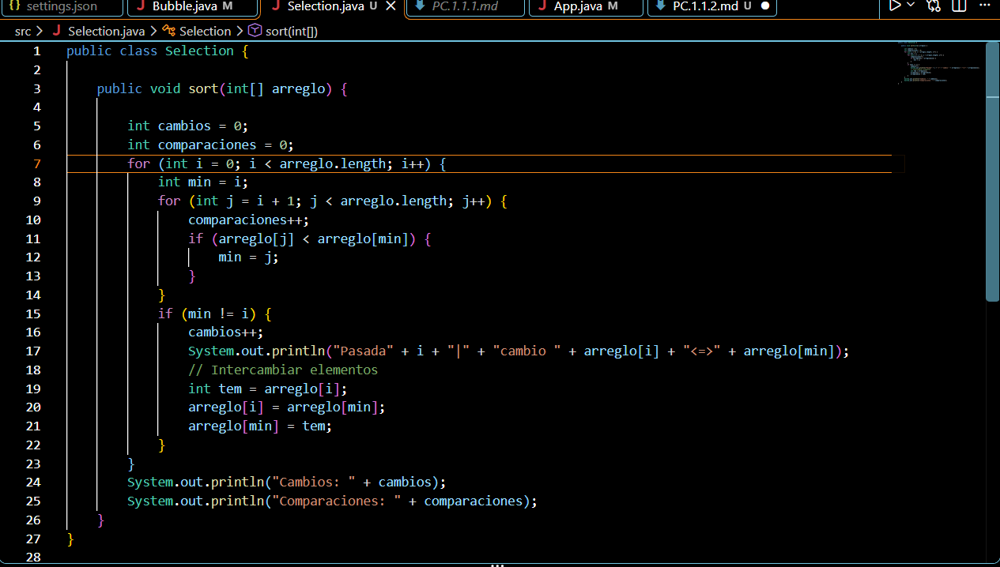
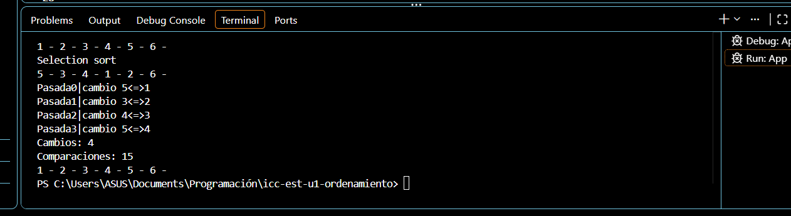

#PC 1.1.2

Metodo Selection

Puse el System en el if del cambio para que vaya contando con la i, la i sería el numero de la pasada que hace el recorrido, y va mostrando que numeros se intercambian

Resultado

